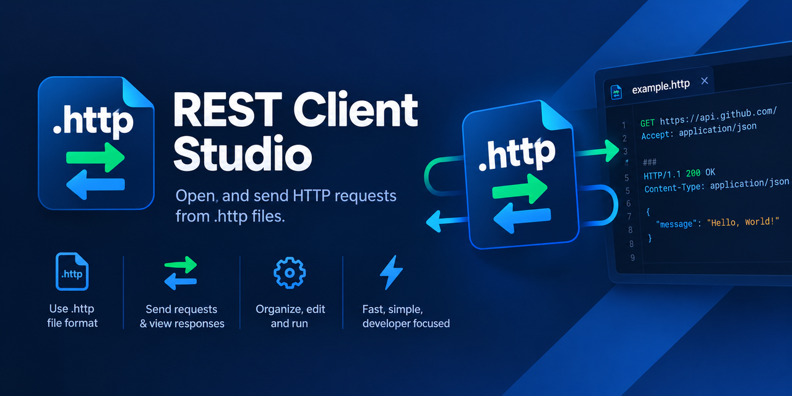
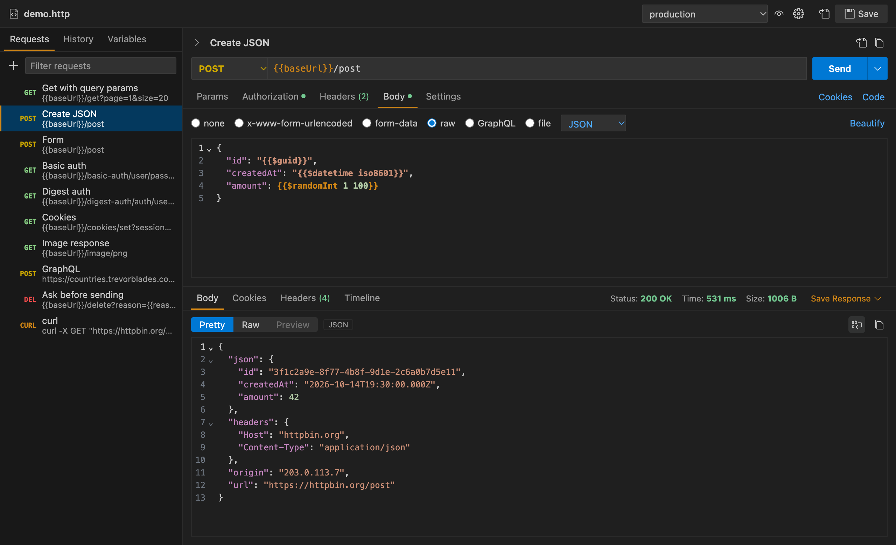
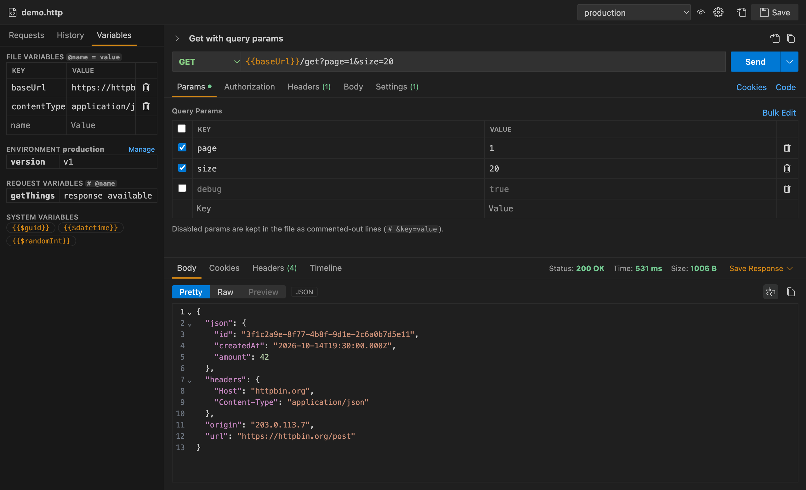
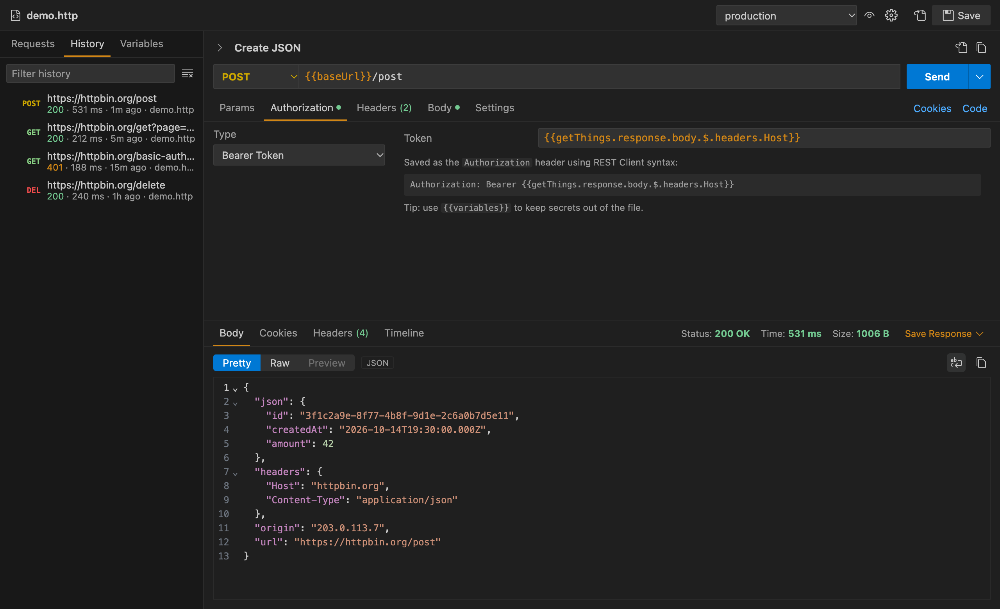
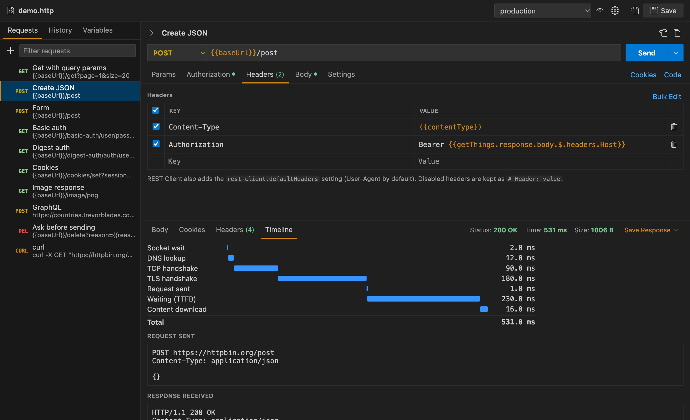
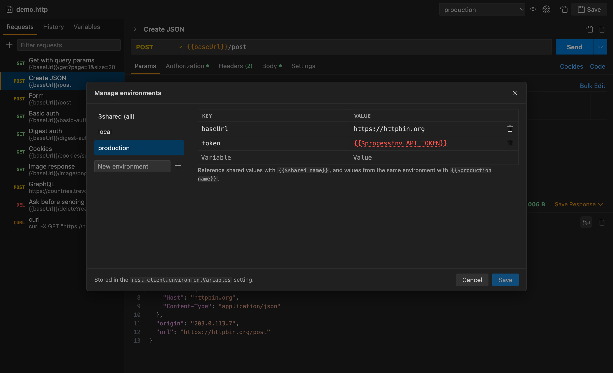
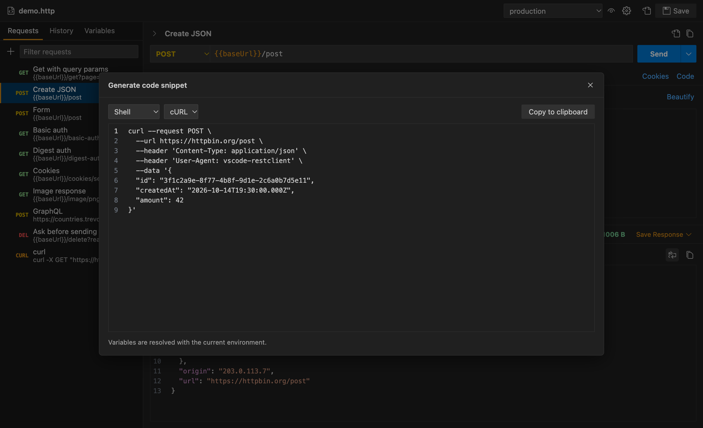
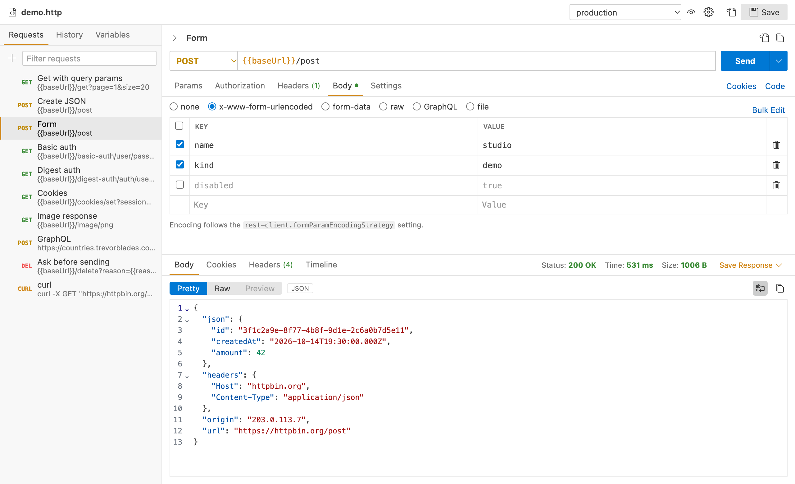

<p align="center"></p>

# REST Client Studio

A visual editor for [REST Client](https://marketplace.visualstudio.com/items?itemName=humao.rest-client) `.http` and `.rest` files.

Studio is an editor for the same plain-text files. Every change is written back to the file in REST Client syntax, and lines you didn't touch are kept byte for byte. You can switch between Studio and the text editor at any time, and keep using REST Client on the same files.



## Opening a file

- Right-click a `.http` / `.rest` file and choose **Open in REST Client Studio**, or click the preview icon in the editor title bar.
- Or use **Open With… → REST Client Studio**.
- To always open these files in Studio, set `"restClientStudio.openByDefault": true`.

Saving, undo/redo and dirty markers behave as in any VS Code editor. Edits made in a text editor on the same file appear in Studio immediately.

## Features

| Area | What you get | Stored in the file as |
|---|---|---|
| Request list | Every request in the file, with filter, new, duplicate, delete and drag-to-reorder | `###` blocks |
| URL bar | Method picker, URL with `{{variable}}` highlighting (red when undefined, hover for the value), Send / Cancel | `METHOD url` |
| Params | Key/value table with enable checkboxes and bulk edit | query string; disabled params as `# &key=value` lines |
| Authorization | No Auth, Basic, Digest, Bearer, AWS Signature v4, custom | `Authorization` header in REST Client syntax |
| Headers | Key/value table with header name suggestions | headers; disabled ones as `# Name: value` |
| Body | none, x-www-form-urlencoded, form-data (text and file parts), raw (JSON / XML / HTML / JS / Text) with Beautify, GraphQL (query + variables), file (`< path` / `<@ path`) | body |
| Settings | `@name`, `@note`, `@no-redirect`, `@no-cookie-jar`, `@prompt` | `# @…` comment lines |
| Response | Status, time, size; Pretty / Raw / Preview (HTML and images); headers; cookies; timing breakdown with the exact request sent; save or copy | — |
| Environments | Picker in the top bar, plus an editor for all environments and `$shared` | `rest-client.environmentVariables` setting |
| Variables | Edit file variables; view environment, request and system variables | `@name = value` lines |
| History | Every sent request with its status and timing; reopen it or add it to the current file | extension storage |
| Code | Generate snippets (curl, fetch, axios, Python, Go, C#, …) or copy as cURL | — |
| Cookies | View and delete cookies in the jar | `~/.rest-client/cookie.json` |

Shortcuts: <kbd>Ctrl/Cmd</kbd>+<kbd>Enter</kbd> sends the selected request. <kbd>Ctrl/Cmd</kbd>+<kbd>S</kbd> saves.

## Screenshots

**Query params and variables.** Disabled params stay in the file as comments, and the Variables panel edits `@name = value` lines.



**Authorization and history**



**Headers and response timeline**



**Environments**



**Code generation**



**Light theme.** Studio follows your VS Code color theme.



## Compatibility with REST Client

Studio runs on its own and does not need REST Client installed. Its parser, variable resolution and HTTP client are ported from REST Client, so requests behave the same:

- It reads the same `rest-client.*` settings: environments, default headers, timeout, redirects, cookies, certificates, proxy, form encoding and others.
- It shares the selected environment (`~/.rest-client/environment.json`) and the cookie jar with REST Client.
- It supports file, environment, request (`{{login.response.body.$.token}}`) and system variables: `$guid`, `$randomInt`, `$timestamp`, `$datetime`, `$localDatetime`, `$processEnv`, `$dotenv`, `$aadV2Token`.

Differences from REST Client 0.26:

- `$aadToken` (deprecated ADAL), `$oidcAccessToken` and `COGNITO` auth aren't supported yet. Send those requests with REST Client.
- `X-Request-Type: GraphQL` is matched case-insensitively. Studio writes `graphql`, which current REST Client releases require.
- Quoted URLs in curl requests (`curl 'https://…'`) work.
- `@no-redirect` and `@no-cookie-jar` can be combined.
- `@prompt` and `@note` use the standard VS Code input box and confirmation dialog.

## Settings

| Setting | Default | Description |
|---|---|---|
| `restClientStudio.openByDefault` | `false` | Open `.http` / `.rest` files in Studio (updates `workbench.editorAssociations`). |
| `restClientStudio.responsePane` | `bottom` | Place the response below (`bottom`) or beside (`right`) the request. |
| `restClientStudio.historyLimit` | `100` | Number of requests kept in history. |

## Development

```sh
npm install
npm run build        # extension (esbuild) + webview (Vite)
npm test             # unit, integration and webview tests (vitest)
npm run test:e2e     # downloads VS Code and runs the extension in it
npm run typecheck
```

Press <kbd>F5</kbd> to launch an Extension Development Host with the `samples/` folder open.

Layout:

- `src/extension/model/`: parses `.http` files into an editable model and writes changes back while keeping untouched text.
- `src/extension/core/`: the parser, variable providers and HTTP client ported from vscode-restclient.
- `src/extension/services/`: request runner, environments, history, cookies, codegen.
- `src/extension/studioEditorProvider.ts`: the custom text editor and the webview message protocol (`src/shared/types.ts`).
- `webview/`: the React UI.

## License

MIT. Includes code from [vscode-restclient](https://github.com/Huachao/vscode-restclient) (MIT); see [THIRD_PARTY_NOTICES.md](THIRD_PARTY_NOTICES.md).
